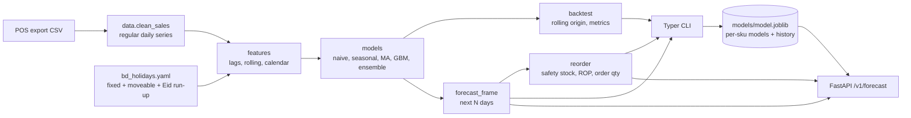

<!-- topics: python,forecasting,scikit-learn,pandas,time-series,retail,inventory-management,typer,fastapi -->
# Inventory Forecasting

Demand forecasting toolkit for small retailers: clean POS exports, build lag and calendar features (with a Bangladesh holiday and Eid run-up calendar), compare baseline and gradient-boosting models with rolling-origin backtests, and turn the forecast into safety stock, reorder points and order quantities. Ships as a Python package, a Typer CLI and an optional FastAPI endpoint.

[](https://github.com/AkibUllah/inventory-forecasting/actions/workflows/ci.yml)


## Try it live

| | |
|---|---|
| API reference | https://akibullah.github.io/inventory-forecasting/ — Swagger UI rendered from the exported `openapi.json` (static; the Codespace runs the real service) |
| Run in your browser | [](https://codespaces.new/AkibUllah/inventory-forecasting?quickstart=1) — installs the package, trains the ensemble on the bundled sample and serves the API on port 8000 (`/docs`); the `invforecast` CLI is on the PATH in the terminal |
| One-click deploy | [](https://render.com/deploy?repo=https://github.com/AkibUllah/inventory-forecasting) — the Dockerfile trains at build time and serves the API |
| Local | `make install train api` or `docker build -t invforecast . && docker run -p 8000:8000 invforecast` (see Quick Start) |

## Why this exists

Shops running the POS systems I have built in Dhaka all reorder the same way: look at the shelf, remember roughly what sold last week, call the supplier. That works until Eid week, a 1 May holiday or a promotion, and then they either run out of soybean oil or sit on a month of detergent. The data to do better is already in the sales table. This toolkit is the smallest useful pipeline on top of it: make the daily series regular (zero-sales days count), add the calendar effects that actually move demand here (Friday/Saturday weekend, salary days, Eid run-up), test models honestly with rolling backtests instead of one lucky split, and convert the forecast into the two numbers a shopkeeper needs: *when* to reorder and *how much*.

## Features

- `load_sales()` / `clean_sales()`: parses dates, trims sku codes, sums duplicate rows, clips returns to zero, fills missing days per sku with zero demand, forward-fills price
- Calendar features: day of week, Bangladeshi weekend (Fri/Sat), month start (salary days), public holidays, Eid days and a configurable pre-Eid run-up window, all from an editable YAML (`invforecast/data/bd_holidays.yaml`, fixed holidays recur, moveable ones listed per year)
- Lag features (1/7/14/28), trailing rolling mean/std/max shifted so they never see the target, promotion flag
- Models behind one interface: naive, seasonal naive (weekly), moving average, scikit-learn `GradientBoostingRegressor` with recursive multi-step forecasting, and a weighted ensemble
- Rolling-origin backtesting with contiguous, non-overlapping folds; MAE, RMSE, MAPE (zero-safe), sMAPE and bias per fold, model and sku; Markdown summary output
- Replenishment maths: service-level z-score (`statistics.NormalDist`), safety stock, reorder point, order quantity over lead time + review period, days of cover
- Synthetic POS generator with trend, weekly seasonality, holiday dips, pre-Eid lift, promotions and Poisson noise; the bundled `data/sample_sales.csv` is reproducible from it (`--seed 42`)
- CLI: `generate-sample`, `train`, `forecast`, `reorder`, `backtest`; FastAPI service: `POST /v1/forecast`, `POST /v1/reorder`, `GET /v1/skus`, `GET /health`
- Pure pandas/scikit-learn; no database, no external services

## Architecture



Key decisions:

- **Zero days are observations, not gaps.** A day with no sale is real demand information; `clean_sales` reindexes every sku to a full daily range and fills with zero, otherwise lags and rolling windows silently skip closed days.
- **Features are built once, used everywhere.** `make_features` is shared by training, recursive prediction and backtesting, so there is no train/serve skew; the GBM forecasts one day at a time and appends its own prediction as the next day's `lag_1`.
- **Backtests use the same code path as production.** Each fold fits a fresh model via the public `build_model()` and calls `predict()` with the fold's real promo calendar, so the metrics describe what the CLI would have produced.
- **Replenishment is explicit, textbook maths.** `safety_stock = z * sigma_daily * sqrt(lead_time)` and `reorder_point = mean_daily * lead_time + safety_stock`; the inputs and the formulas are visible in the output so a shop owner can argue with them.
- **Holidays are data, not code.** The YAML is the integration point for the yearly gazette; Eid dates are approximations by design and labelled as such.

## Backtest results

Rolling-origin backtest on the bundled sample (`data/sample_sales.csv`: 4 skus, 365 days, weekly seasonality, promotions, holidays, Poisson noise), 14-day horizon, 6 folds per sku, produced by:

```bash
invforecast backtest data/sample_sales.csv --horizon 14 --splits 6 --markdown
```

| Model | MAE | RMSE | MAPE % | sMAPE % | Bias | Folds |
|---|---:|---:|---:|---:|---:|---:|
| ensemble | 3.44 | 4.33 | 31.7 | 25.1 | +0.32 | 24 |
| gradient_boosting | 3.39 | 4.21 | 30.9 | 25.3 | +0.23 | 24 |
| moving_average | 3.97 | 4.96 | 34.8 | 27.7 | +0.27 | 24 |
| seasonal_naive | 4.55 | 5.84 | 40.6 | 33.0 | +0.45 | 24 |
| naive | 4.86 | 6.05 | 38.4 | 36.5 | -0.77 | 24 |

Reading it: units are items per day averaged over skus selling 4 to 25 a day. Gradient boosting cuts error by about 30% versus naive and 15% versus a 28-day moving average; the ensemble trades a little MAE for the most stable sMAPE. MAPE above 30% is expected on low-volume Poisson-like demand (a day with 2 sales forecast at 3 is a 50% error), which is why sMAPE and MAE are the headline metrics for reorder decisions. Bias is small and positive for every learned model: slight over-forecasting, which is the safe direction for stock.

## Tech Stack

| Layer | Choice |
| --- | --- |
| Language | Python 3.10+ |
| Data | pandas 2, numpy |
| Models | scikit-learn GradientBoostingRegressor, hand-written baselines, joblib bundles |
| CLI | Typer + Rich tables |
| API (optional) | FastAPI + Pydantic v2 (`pip install "inventory-forecasting[api]"`) |
| Config | YAML holiday calendar, env vars for the API (`.env.example`) |
| Tooling | pytest, ruff, GitHub Actions (3.10 / 3.11), Dockerfile that trains at build time |

## Quick Start

### Local

```bash
git clone https://github.com/AkibUllah/inventory-forecasting.git && cd inventory-forecasting
make install                      # venv + pip install -e ".[dev]"
make backtest                     # the table above
make train                        # models/model.joblib (ensemble, one model per sku)
make forecast                     # next 14 days per sku
make reorder                      # safety stock / reorder point / order qty
```

### Docker (API)

```bash
docker build -t invforecast .     # trains on the sample data during the build
docker run -p 8000:8000 invforecast
curl -s -X POST localhost:8000/v1/forecast -H 'Content-Type: application/json' -d '{"sku": "RICE-MINI-5KG", "horizon": 7}'
curl -s -X POST localhost:8000/v1/reorder  -H 'Content-Type: application/json' \
  -d '{"sku": "OIL-SOY-1L", "on_hand": 40, "on_order": 50, "lead_time_days": 7, "service_level": 0.95}'
```

## Usage

### CLI

```bash
invforecast generate-sample data/sample_sales.csv --days 365 --skus 4 --seed 42
invforecast train data/sample_sales.csv --model gradient_boosting --out models/gbm.joblib
invforecast forecast models/gbm.joblib --horizon 14 --sku RICE-MINI-5KG --json
invforecast reorder models/gbm.joblib --lead-time 7 --service-level 0.95 --stock stock.csv
invforecast backtest data/sample_sales.csv --horizon 7 --splits 8 --models seasonal_naive,gradient_boosting
```

`stock.csv` is `sku,on_hand[,on_order]`. Your own POS export needs `date,sku,units_sold` and may include `promo` (0/1) and `price`.

`invforecast reorder` on the sample bundle with a 7-day lead time and 95% service level:

```
sku                on hand   avg/day   safety stock   reorder point   order qty   order?
DETERGENT-1KG            5       7.8           15.7            69.9          62   yes
OIL-SOY-1L              40      27.8           35.6           230.1         124   yes
RICE-MINI-5KG           60      18.9           24.9           157.0          97   yes
TEA-ISPAHANI-400G      120       8.4           11.9            70.8           0   no
```

(`OIL-SOY-1L` has 50 units on order, which is why its order quantity is lower than the gap to the reorder point.)

### Library

```python
from invforecast.data import load_sales, series_for
from invforecast.models import GradientBoostingForecaster, forecast_frame
from invforecast.reorder import recommend

sales = load_sales("data/sample_sales.csv")
history = series_for(sales, "OIL-SOY-1L")
model = GradientBoostingForecaster().fit(history)
forecast = forecast_frame(history, model.predict(14))

rec = recommend(
    "OIL-SOY-1L",
    history_units=history["units_sold"],
    forecast_units=forecast["forecast"],
    on_hand=40,
    on_order=50,
    lead_time_days=7,
    service_level=0.95,
)
print(rec.reorder_point, rec.recommended_order_qty, rec.should_order)
```

### Custom holiday calendar

Copy `invforecast/data/bd_holidays.yaml`, adjust the moveable dates when the gazette is out, add shop closures under `custom:` and pass `--holidays my_calendar.yaml` to `train`.

## Project Structure

```
inventory-forecasting/
├── invforecast/
│   ├── data.py          # load_sales / clean_sales / series_for
│   ├── holidays.py      # HolidayCalendar from YAML (fixed, moveable, Eid run-up)
│   ├── features.py      # calendar + lag/rolling features, make_features
│   ├── models.py        # Forecaster protocol, baselines, GBM, ensemble, build_model
│   ├── metrics.py       # mae, rmse, mape, smape, bias
│   ├── backtest.py      # make_folds, backtest, summarize, to_markdown
│   ├── reorder.py       # z_score, safety_stock, reorder_point, recommend
│   ├── sample.py        # synthetic POS generator
│   ├── cli.py           # Typer app (invforecast ...)
│   ├── api.py           # FastAPI wrapper around a trained bundle
│   └── data/bd_holidays.yaml
├── data/sample_sales.csv
├── tests/
├── Dockerfile · Makefile · .github/workflows/ci.yml
└── pyproject.toml · requirements*.txt · .env.example
```

## Testing

```bash
make test        # pytest -q
make lint
```

Covered: cleaning (gap filling, duplicate summing, negative clipping, bad dates), calendar features against known 2025 dates (Friday weekend, Independence Day, Eid span and run-up), custom YAML calendars, lag/rolling leakage guards, feature shapes, metric formulas and edge cases, exact baseline predictions on a regular weekly pattern, GBM learning the weekday shape, ensemble weighting, fold construction, backtest shapes and Markdown summary, z-scores against the standard table, safety stock / reorder point / order quantity cases, CLI end to end (generate, train, forecast, reorder, backtest) and error paths, API forecast/reorder/404/422/503.

## Roadmap

- Intermittent-demand models (Croston / TSB) for slow movers where Poisson noise dominates
- Lead-time variability in the safety-stock formula and supplier minimum order quantities
- Hierarchical reconciliation (sku -> category -> store) and multi-store support
- Quantile forecasts (GBM with quantile loss) to drive service level directly
- Scheduled retraining and forecast drift monitoring in the API

## License

MIT - see [LICENSE](LICENSE).
